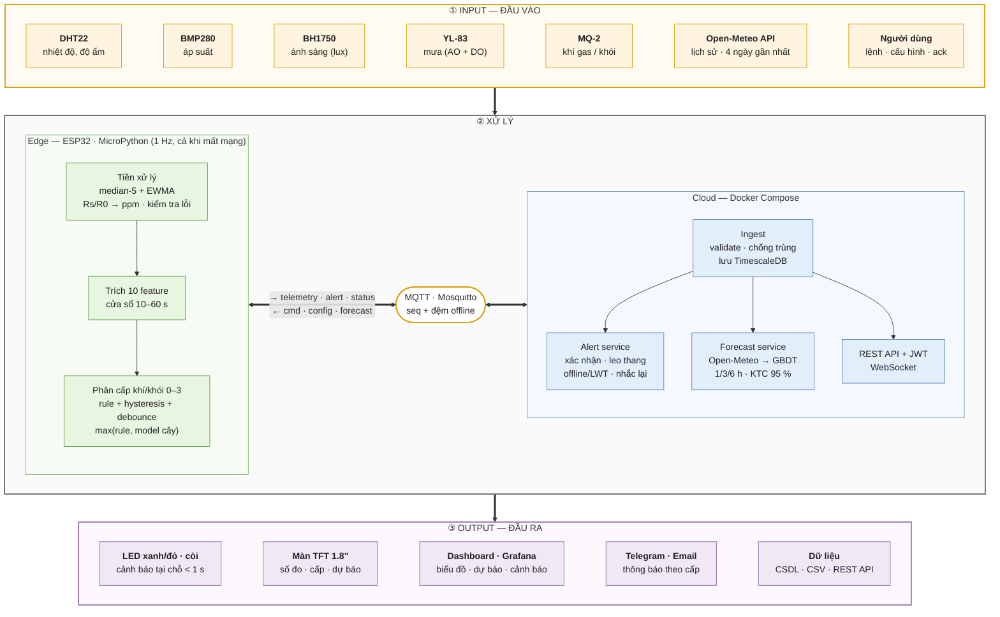
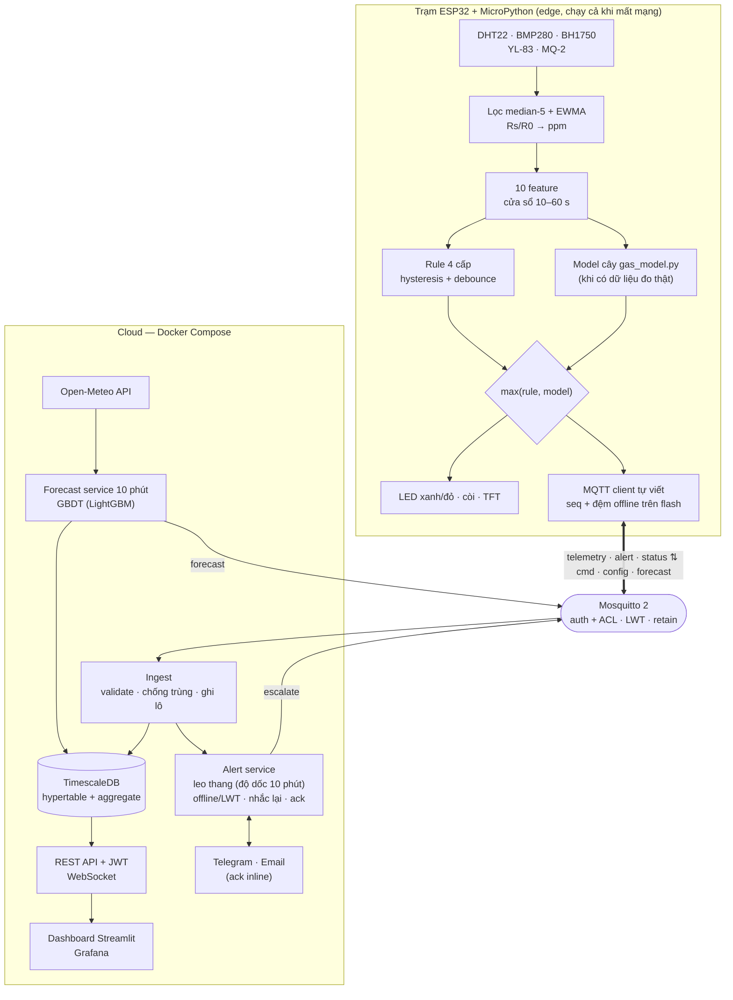
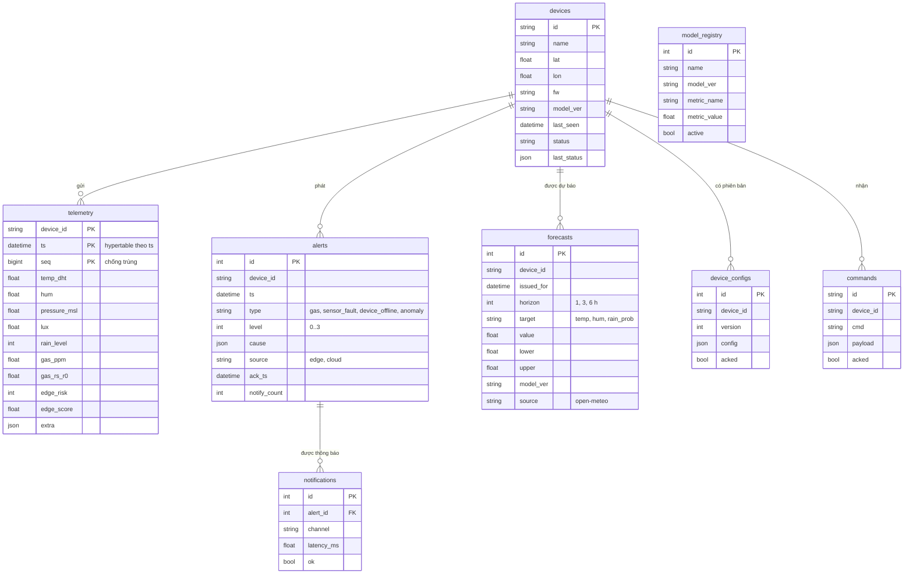

# Sơ đồ kiến trúc và CSDL

Ảnh PNG sinh bằng `python tools/render_mermaid.py` → `docs/report/figures/diagrams/`.

## Sơ đồ hệ thống Input – Xử lý – Output

## Kiến trúc tổng thể (AI lai edge–cloud)

## Lược đồ CSDL (ERD)

