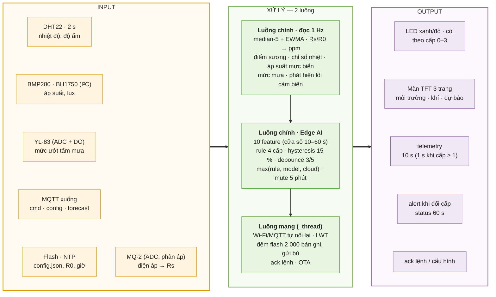
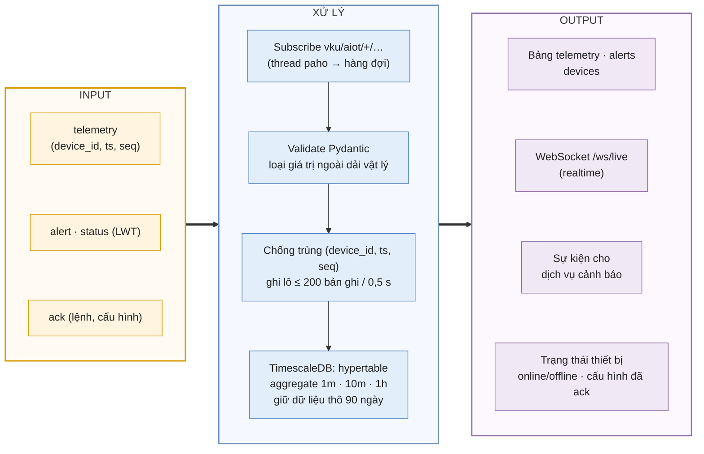
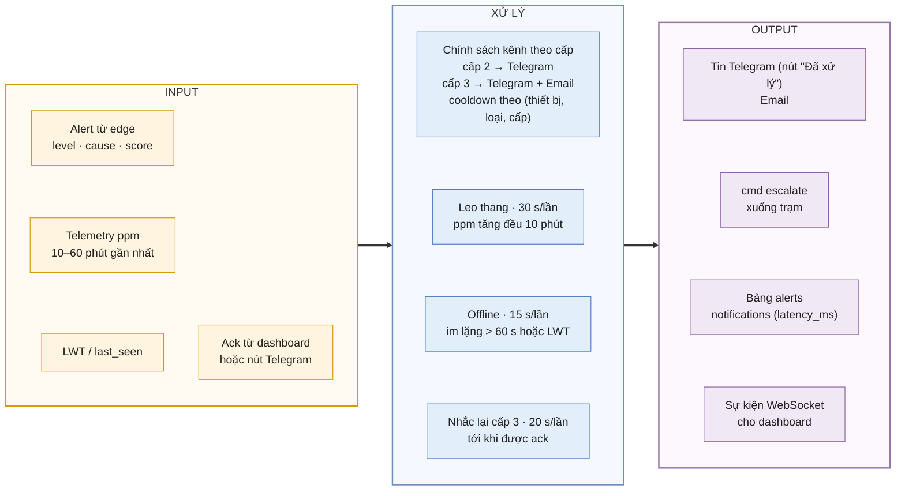
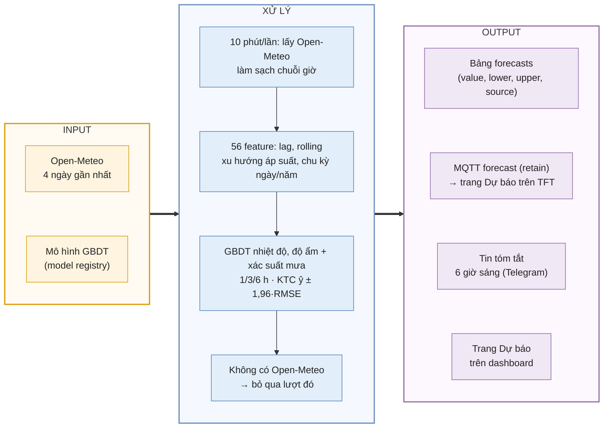
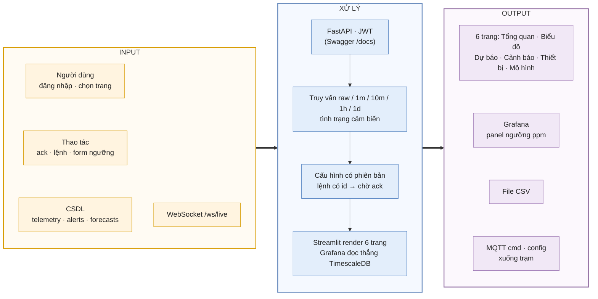
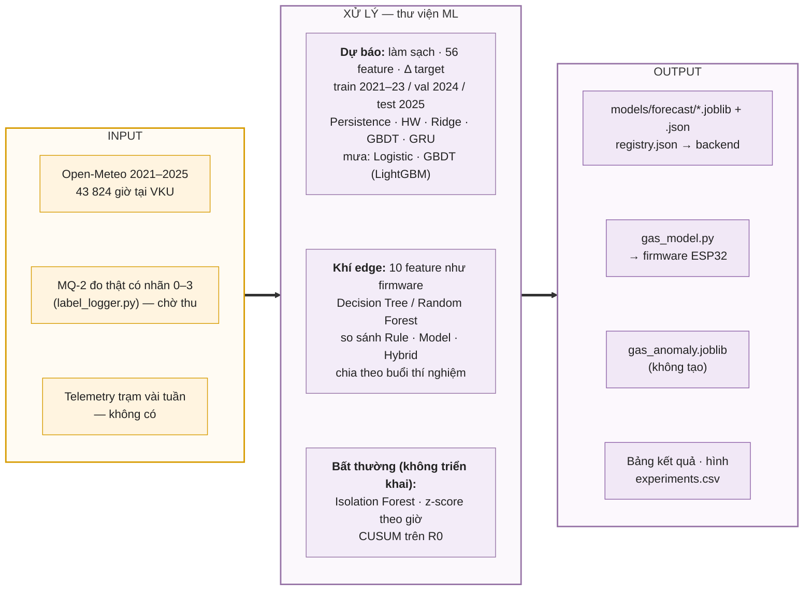

# Dự án theo mô hình Input – Xử lý – Output (IPO)

Toàn bộ dự án được phân rã theo **mô hình IPO** ở hai mức:

- **Mức 0 — toàn hệ thống:** ảnh `so_do_he_thong_input_xu_ly_output.png` (nguồn trong `diagrams.md`).
- **Mức 1 — 6 phân hệ:** mỗi phân hệ có một sơ đồ IPO và một bảng IPO ở dưới. Output của phân hệ này là Input của phân hệ
  kế tiếp, nối thành chuỗi: **cảm biến → edge → MQTT → ingest → cảnh báo / dự báo → dashboard, thông báo**, cộng
  thêm vòng phản hồi (lệnh, cấu hình, bản tin dự báo trả về trạm) và vòng huấn luyện offline (mô hình nạp vào backend/firmware).

Ảnh PNG sinh bằng `python tools/render_mermaid.py` → `docs/report/figures/diagrams/ipo_*.png`.

## Bảng tổng hợp

| #   | Phân hệ                     | Input                                                       | Xử lý                                                                                     | Output                                                     | Nơi chạy                               |
| --- | --------------------------- | ----------------------------------------------------------- | ----------------------------------------------------------------------------------------- | ---------------------------------------------------------- | -------------------------------------- |
| 1   | Firmware edge (MicroPython) | Tín hiệu 5 cảm biến; lệnh/cấu hình/bản tin dự báo qua MQTT  | Lọc, tính ppm, 10 feature, phân cấp 0–3, đệm offline                                      | LED, còi, màn TFT; bản tin telemetry/alert/status          | ESP32 + MicroPython (`firmware/src/`)  |
| 2   | Truyền thông MQTT           | Bản tin từ trạm và từ backend                               | Xác thực + ACL, LWT, retain, QoS 0/1                                                      | Bản tin chuyển đến đúng bên nhận                           | Mosquitto (`broker/`)                  |
| 3   | Thu nhận và lưu trữ         | telemetry, alert, status, ack                               | Validate, loại giá trị ngoài dải, chống trùng, ghi lô, gộp theo thời gian                 | Bảng CSDL, luồng WebSocket, sự kiện cho dịch vụ cảnh báo   | Backend (`backend/app/mqtt/ingest.py`) |
| 4   | Cảnh báo cloud              | Alert edge, telemetry 10–60 phút, LWT, ack                  | Chính sách kênh theo cấp, cooldown, leo thang, phát hiện offline, nhắc lại                | Telegram/Email, lệnh `escalate`, bảng alerts/notifications | Backend (`alert_service.py`)           |
| 5   | Dự báo cloud                | Open-Meteo 4 ngày gần nhất, mô hình GBDT                    | Làm sạch, 56 feature, GBDT, khoảng tin cậy                                                | Dự báo 1/3/6 h, bản tin TFT, tin 6 giờ sáng                | Backend (`forecast_service.py`)        |
| 6   | Dashboard và API            | Thao tác người dùng, dữ liệu CSDL                           | JWT, REST, WebSocket, cấu hình có phiên bản                                               | 6 trang Streamlit, Grafana, CSV, lệnh/cấu hình xuống trạm  | `backend/app/api/`, `dashboard/`       |
| 7   | Huấn luyện offline          | Open-Meteo 2021–2025; dữ liệu MQ-2 gán nhãn; telemetry trạm | scikit-learn, LightGBM, statsmodels, PyTorch: feature, huấn luyện, chọn mô hình, đánh giá | File mô hình + registry, `gas_model.py`, bảng kết quả      | Laptop (`ml/`)                         |

## IPO-1 Firmware ESP32 (edge)

|            | Nội dung                                                                                                                                                                                                                                                                                                                                                                                                                                                                                                                                                                                                                                                                                                                                                                                              |
| ---------- | ----------------------------------------------------------------------------------------------------------------------------------------------------------------------------------------------------------------------------------------------------------------------------------------------------------------------------------------------------------------------------------------------------------------------------------------------------------------------------------------------------------------------------------------------------------------------------------------------------------------------------------------------------------------------------------------------------------------------------------------------------------------------------------------------------- |
| **Input**  | DHT22 (nhiệt độ, độ ẩm, 2 s/lần); BMP280 (áp suất), BH1750 (lux) qua I²C; YL-83 (điện áp AO + DO, chỉ cấp nguồn khi đọc); MQ-2 (điện áp AO qua cầu phân áp 10k/20k); MQTT xuống: `cmd` (mute, test_alarm, calibrate, reboot, escalate, ota), `config` (ngưỡng, hysteresis, debounce, chu kỳ, chế độ rule/model/hybrid), `forecast`; `/config.json` trên flash (cấu hình, R0); NTP (giờ).                                                                                                                                                                                                                                                                                                                                                                                                              |
| **Xử lý**  | Luồng chính, đọc 1 Hz (`sensors.py`, `readings.py`): lọc median-5 + EWMA, Rs = RL·(Vc − Vout)/Vout, ppm = 574,25·(Rs/R0)^−2,222, điểm sương, chỉ số nhiệt, quy áp suất về mực biển, phân mức mưa (giữ mức cao nhất trong 3 lần đọc), phát hiện lỗi MQ-2 (kẹt, mất kết nối, bão hoà). Edge AI (`edge_ai.py`, `alert.py`): 10 feature (ppm, Rs/R0, độ dốc 10 s, độ lệch chuẩn 30 s, độ lệch so với nền, nhiệt độ, độ dốc nhiệt độ, độ ẩm, độ dốc độ ẩm, lux tương đối) → rule 4 cấp (300/1 000/2 000 ppm, độ dốc ≥ 15 ppm/s, nhiệt tăng ≥ 1 °C/phút) → `max(rule, model, cloud)`; mute 5 phút. Luồng mạng `_thread` (`net.py`, `mqtt.py` tự viết): kết nối lại, publish, đệm offline trên flash, gửi bù 20 bản ghi/lượt, ack, OTA. Watchdog `machine.WDT` 30 s chỉ được cho ăn khi luồng mạng còn sống. |
| **Output** | Tại chỗ: LED xanh (cấp 0; nháy 1 Hz ở cấp 1), LED đỏ nháy + còi ngắt quãng (cấp 2), LED đỏ + còi liên tục (cấp 3); màn TFT 3 trang luân phiên 4 s (cấp ≥ 2 luôn hiện trang khí). Lên cloud: `telemetry`, `alert` (level, prev_level, cause, score), `status` (retain, LWT), `ack`.                                                                                                                                                                                                                                                                                                                                                                                                                                                                                                                    |

## IPO-2 Thu nhận và lưu trữ (ingest)

|            | Nội dung                                                                                                                                                                                                                                                                                                                                                                                                                              |
| ---------- | ------------------------------------------------------------------------------------------------------------------------------------------------------------------------------------------------------------------------------------------------------------------------------------------------------------------------------------------------------------------------------------------------------------------------------------- |
| **Input**  | Bản tin MQTT `telemetry`, `alert`, `status` (gồm LWT offline), `ack` từ mọi trạm.                                                                                                                                                                                                                                                                                                                                                     |
| **Xử lý**  | Thread paho đưa bản tin vào hàng đợi; worker validate bằng Pydantic; giá trị ngoài dải vật lý bị loại và ghi vào `extra.rejected`; bản tin trước khi có giờ NTP bị bỏ; telemetry gom lô (≤ 200 bản ghi hoặc 0,5 s) rồi `INSERT … ON CONFLICT DO NOTHING` theo khoá (device_id, ts, seq), nhờ đó gửi bù không bị trùng; alert xử lý ngay để giảm độ trễ. TimescaleDB tự làm mới 3 continuous aggregate và xoá dữ liệu thô sau 90 ngày. |
| **Output** | Bản ghi trong các bảng `telemetry`, `alerts`, `devices` (last_seen, status), `device_configs`/`commands` (đánh dấu đã ack); đẩy realtime qua WebSocket `/ws/live`; chuyển alert edge sang dịch vụ cảnh báo.                                                                                                                                                                                                                           |

## IPO-3 Dịch vụ cảnh báo (cloud)

|            | Nội dung                                                                                                                                                                                                                                                                                                                                                                |
| ---------- | ----------------------------------------------------------------------------------------------------------------------------------------------------------------------------------------------------------------------------------------------------------------------------------------------------------------------------------------------------------------------- |
| **Input**  | Alert edge (cấp, cấp trước, nguyên nhân, điểm số); telemetry ppm trong cửa sổ 10–60 phút; LWT và thời điểm nhận bản tin cuối; ack từ API/dashboard hoặc nút inline Telegram.                                                                                                                                                                                            |
| **Xử lý**  | Chọn kênh theo loại và cấp (cấp 2 → Telegram; cấp 3 → Telegram + Email; về bình thường sau cấp ≥ 2 → Telegram; lỗi cảm biến/offline → Telegram; thử còi → không gửi) và cooldown; mỗi 30 s đánh giá leo thang (độ dốc ppm dương ở cả hai nửa cửa sổ 10 phút) → nâng 1 cấp; mỗi 15 s kiểm tra offline (> 60 s hoặc LWT); mỗi 20 s nhắc lại cảnh báo cấp 3 chưa được ack. |
| **Output** | Tin Telegram/Email; lệnh `cmd escalate` xuống trạm (edge nâng cấp theo); bản ghi `alerts` (source = edge/cloud, ack_ts, notify_count) và `notifications` (kênh, độ trễ, thành công); sự kiện realtime cho dashboard.                                                                                                                                                    |

## IPO-4 Dịch vụ dự báo (cloud)

|            | Nội dung                                                                                                                                                                                                                                                                         |
| ---------- | -------------------------------------------------------------------------------------------------------------------------------------------------------------------------------------------------------------------------------------------------------------------------------- |
| **Input**  | Quan trắc Open-Meteo 4 ngày gần nhất (chỉ các giờ đã qua) tại toạ độ trạm; các mô hình GBDT đang hoạt động trong `ml/models/registry.json`. Số đo của trạm không dùng làm đầu vào.                                                                                               |
| **Xử lý**  | APScheduler chạy 10 phút/lần: làm sạch chuỗi giờ; tạo 56 feature; GBDT dự báo thay đổi Δ của nhiệt độ/độ ẩm và xác suất mưa ở 1/3/6 giờ; khoảng tin cậy 95 % = ŷ ± 1,96·RMSE_test; độ ẩm kẹp trong [0, 100]. Không lấy được Open-Meteo → bỏ qua lượt đó, không phát bản tin mới. |
| **Output** | Bảng `forecasts` (giá trị, cận dưới/trên, phiên bản mô hình, nguồn); bản tin `forecast` retain gửi về trạm, hiện trên trang "Du bao" của TFT; tin tóm tắt thời tiết lúc 6 giờ sáng; dữ liệu cho trang Dự báo của dashboard.                                                      |

## IPO-5 Dashboard và REST API

|            | Nội dung                                                                                                                                                                                                                                                                              |
| ---------- | ------------------------------------------------------------------------------------------------------------------------------------------------------------------------------------------------------------------------------------------------------------------------------------- |
| **Input**  | Thao tác người dùng: đăng nhập, chọn trang (hoặc mở thẳng bằng `?page=` từ link Telegram), xác nhận cảnh báo, gửi lệnh (thử còi, tắt còi, hiệu chuẩn R0, khởi động lại), sửa ngưỡng/chu kỳ; dữ liệu trong CSDL; luồng realtime từ WebSocket.                                          |
| **Xử lý**  | FastAPI kiểm tra JWT; truy vấn telemetry theo độ phân giải raw/1m/10m/1h/1d; tính tình trạng từng cảm biến; lưu cấu hình thành phiên bản mới và publish `config` (retain), lệnh có id và chờ `ack`; Streamlit vẽ biểu đồ theo giờ địa phương; Grafana truy vấn TimescaleDB trực tiếp. |
| **Output** | 6 trang Streamlit (Tổng quan, Biểu đồ, Dự báo, Cảnh báo, Thiết bị, Mô hình); dashboard Grafana; file CSV; bản tin `cmd`/`config` gửi xuống trạm.                                                                                                                                      |

## IPO-6 Huấn luyện mô hình offline (thư viện chuẩn)

| Pipeline                             | Input                                                                    | Xử lý                                                                                                                                                                                         | Output                                                                                                                                | Trạng thái                                |
| ------------------------------------ | ------------------------------------------------------------------------ | --------------------------------------------------------------------------------------------------------------------------------------------------------------------------------------------- | ------------------------------------------------------------------------------------------------------------------------------------- | ----------------------------------------- |
| Dự báo thời tiết (`train_forecast`)  | Open-Meteo theo giờ 2021–2025 tại 15,975°N 108,253°E (43 824 giờ)        | Làm sạch (z-score cuộn, nội suy ≤ 3 giờ); 56 feature không rò rỉ tương lai; target Δ = x(t+h) − x(t); chia theo thời gian; so sánh 6 mô hình hồi quy + 3 mô hình mưa; early stopping trên val | 9 mô hình GBDT (6 hồi quy + 3 mưa) + `registry.json`; `results_forecast.md`; hình. **MAE nhiệt độ 1 h = 0,30 °C, F1 mưa 3 h = 0,833** | Đã xong                                   |
| Cảnh báo khí edge (`train_gas_edge`) | CSV 1 Hz đo thật, nhãn 0–3 theo kịch bản (gas ở 50/20/5 cm, khói, nhiễu) | Cùng 10 feature với firmware (`gas_edge.py` ≡ `edge_ai.py`, có test); DT/RF có trọng số lớp; chia theo buổi; so khớp `gas_model.py` (float32) với scikit-learn                                | `firmware/src/gas_model.py`, `gas_edge.joblib`, `results_gas_edge.md`                                                                 | Chờ dữ liệu MQ-2 đo thật; edge chạy rule  |
| Bất thường cloud (`train_anomaly`)   | Cần vài tuần telemetry trạm — **không có**                               | 8 feature cửa sổ 10 phút; Isolation Forest; z-score theo giờ; CUSUM trên R0 hằng ngày                                                                                                         | `gas_anomaly.joblib` cho alert service; đề xuất hiệu chuẩn lại MQ-2                                                                   | Không triển khai; backend bỏ qua bước này |

## Vòng phản hồi

| Vòng               | Output của                 | trở thành Input của        | Đường đi                                                                       |
| ------------------ | -------------------------- | -------------------------- | ------------------------------------------------------------------------------ |
| Lệnh và cấu hình   | Dashboard (IPO-5)          | Firmware (IPO-1)           | API → MQTT `cmd`/`config` → ESP32 → `ack` → ingest                             |
| Leo thang          | Dịch vụ cảnh báo (IPO-3)   | Firmware (IPO-1)           | `cmd escalate` → `max(rule, model, cloud)` → còi/LED                           |
| Bản tin dự báo     | Dịch vụ dự báo (IPO-4)     | Firmware (IPO-1)           | MQTT `forecast` retain → trang Dự báo trên TFT                                 |
| Mô hình            | Huấn luyện offline (IPO-6) | Dự báo, cảnh báo, firmware | `registry.json`, `gas_anomaly.json`, `gas_model.py` (nạp bằng `deploy.py`/OTA) |
| Dữ liệu huấn luyện | Ingest (IPO-2)             | Huấn luyện offline (IPO-6) | Xuất CSV telemetry → `train_anomaly`; `label_logger.py` → `train_gas_edge`     |
