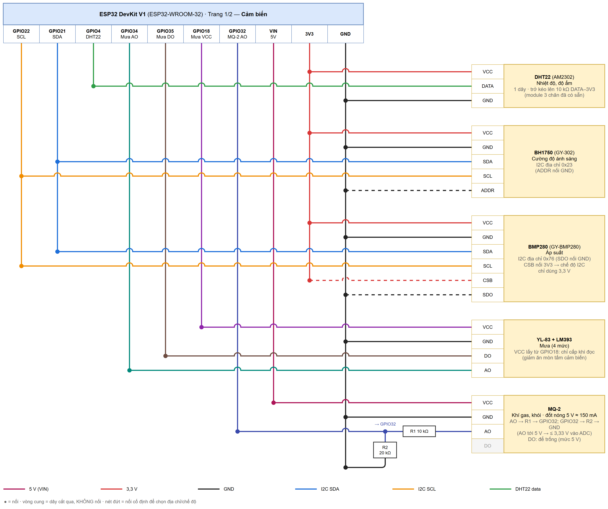
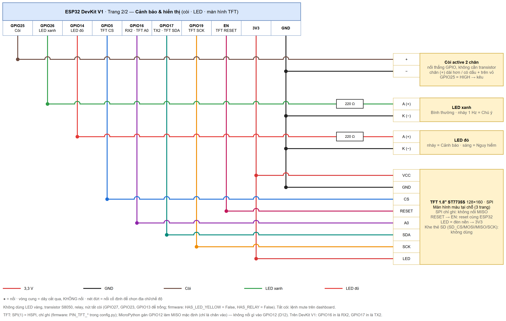

# Phần cứng — sơ đồ đấu dây

**Trang 1 — Cảm biến**

**Trang 2 — Cảnh báo (còi, LED) và màn hình TFT**

Chấm tròn = nối · vòng cung = dây cắt qua, **không** nối · nét đứt = nối cố định để chọn địa chỉ/chế độ.

- **`wiring.drawio`** (2 trang): mở bằng [draw.io / diagrams.net](https://app.diagrams.net) (File → Open) để xem và sửa.
- `wiring-1.png`, `wiring-2.png`: ảnh xuất cho báo cáo/slide.
- Sinh lại sau khi đổi chân: sửa `gen_wiring_drawio.py` **và** `firmware/src/config.py`, rồi
  `python docs/hardware/gen_wiring_drawio.py` và `python tools/render_drawio.py docs/hardware/wiring.drawio`.

## Bảng đấu dây

Trên board ESP32 DevKit V1, chân GPIOx thường in là **Dx** (D5, D19…); riêng **GPIO16 in là RX2**, **GPIO17 in là TX2**
(nằm giữa D5 và D4, cùng hàng chân với D23/D22).

| Linh kiện | Chân linh kiện | Nối tới | Ghi chú |
|---|---|---|---|
| Nguồn 5 V / 2 A | +5V / GND | VIN / GND của ESP32, MQ-2 | GND chung toàn mạch |
| BMP280 | VCC / GND / SCL / SDA / SDO | 3V3 / GND / GPIO22 / GPIO21 / GND | địa chỉ 0x76 |
| BH1750 | VCC / GND / SCL / SDA / ADDR | 3V3 / GND / GPIO22 / GPIO21 / GND | địa chỉ 0x23 |
| DHT22 | VCC / DATA / GND | 3V3 / GPIO4 / GND | trở kéo lên 10 kΩ DATA → 3V3 |
| YL-83 (LM393) | VCC / GND / AO / DO | **GPIO18** / GND / GPIO34 / GPIO35 | GPIO18 chỉ cấp nguồn khi đọc (giảm ăn mòn) |
| MQ-2 | VCC / GND / AO / DO | 5V / GND / **R1 10 kΩ → GPIO32**, R2 20 kΩ GPIO32 → GND / *để trống* | AO tối đa 5 V → 3,33 V |
| Còi active 2 chân | + / − | GPIO25 / GND | nối thẳng, không cần transistor; chân + dài hơn; GPIO = HIGH → kêu |
| LED xanh / đỏ | anode / cathode | 220 Ω ← GPIO26 / 14 · GND | cấp 1 = xanh nháy 1 Hz (không có LED vàng) |
| Màn hình TFT 1.8" ST7735S 128×160 (SPI) | VCC / GND / CS / RESET / A0 / SDA / SCK / LED | 3V3 / GND / **GPIO5** / **EN** / **GPIO16 (RX2)** / **GPIO17 (TX2)** / **GPIO19** / 3V3 | SPI chỉ ghi (HSPI); không nối MISO, không nối GPIO12; khe thẻ SD bỏ trống |
| *(không dùng)* LED vàng, transistor S8050, relay/quạt, nút tắt còi | — | GPIO27, GPIO23, GPIO13 để trống | `config.py`: `HAS_LED_YELLOW = False`, `HAS_RELAY = False`; tắt còi bằng lệnh `mute` trên dashboard |

## Kiểm tra trước khi cấp điện
1. Đo thông mạch GND chung; không chập 5V–GND, 3V3–GND.
2. Đo điện áp nút giữa R1/R2 khi MQ-2 cấp 5 V: phải ≤ 3,3 V.
3. Nạp firmware (`python firmware/deploy.py`), mở `python -m mpremote connect COM3 repl`: log
   `[SENS] I2C ['0x23', '0x76'] BMP280:1 BH1750:1`; màn TFT hiện
   "Tram AIoT" rồi 3 trang luân phiên.
5. Màn TFT: trắng xoá / sai màu / lệch 1–2 hàng điểm ở mép → đổi `TFT_TAB` trong `config.py`
   (`"black"` → `"green"` hoặc `"red"`); hình ngược → `TFT_ROTATION = 3`. Module có ổn áp
   3,3 V và jumper J1: cấp VCC = 3V3 là an toàn trong mọi trường hợp; **không** cấp 5 V nếu J1 đã được hàn nối.
4. MQ-2 cần làm nóng 24–48 giờ trước khi hiệu chuẩn R0 (lệnh `calibrate` trên dashboard).
