# TRẠM QUAN TRẮC MÔI TRƯỜNG AIoT: DỰ BÁO THỜI TIẾT NGẮN HẠN VÀ CẢNH BÁO SỚM KHÍ GAS/KHÓI ĐA CẤP VỚI AI LAI EDGE–CLOUD

**Trường Đại học Công nghệ Thông tin và Truyền thông Việt – Hàn (VKU), Đại học Đà Nẵng**

| | |
|---|---|
| Học phần | Lập trình Python — Đồ án cuối kỳ |
| Sinh viên thực hiện | *(họ tên, MSSV)* |
| Giảng viên hướng dẫn | *(họ tên)* |
| Thời gian | 11/2026 |
| Mã nguồn | https://github.com/danhle396/pythonnhung |

> **Lưu ý quan trọng.** Hệ thống là **nguyên mẫu học thuật**, không thay thế thiết bị báo cháy/báo gas đã được chứng nhận.
> Báo cáo **chỉ dùng số liệu đo thật**: dự báo thời tiết huấn luyện trên dữ liệu quan trắc lịch sử Open-Meteo tại VKU.
> Tại thời điểm viết, **chưa có dữ liệu khí MQ-2 đo thật** nên mô hình học máy cho cảnh báo khí chưa được huấn luyện —
> trạm cảnh báo bằng luật ngưỡng; các mục cần đo trên phần cứng được đánh dấu ⚙.

---

## TÓM TẮT

Đồ án xây dựng một trạm quan trắc môi trường dùng ESP32 với năm loại cảm biến (DHT22, BMP280, BH1750, YL-83, MQ-2),
truyền dữ liệu qua MQTT về một backend Python (FastAPI + TimescaleDB). Hệ thống giải hai bài toán:
(1) **dự báo thời tiết ngắn hạn** 1/3/6 giờ cho nhiệt độ, độ ẩm, áp suất và khả năng mưa tại VKU (15,975°N; 108,253°E);
(2) **cảnh báo sớm khí gas/khói 4 cấp** (Bình thường – Chú ý – Cảnh báo – Nguy hiểm).

Điểm chính của thiết kế là **AI lai edge–cloud**: quyết định an toàn (cảnh báo khí) chạy ngay trên ESP32 bằng luật có
hysteresis/debounce, nên vẫn hoạt động khi mất mạng; firmware có sẵn khung nạp mô hình cây (Random Forest biên dịch sang
C) để kết hợp với luật khi có dữ liệu khí đo thật. Cloud đảm nhận các tác vụ cần ngữ cảnh dài và tài nguyên lớn:
xác nhận/leo thang cảnh báo, dự báo thời tiết bằng Gradient Boosting, thông báo Telegram/Email, lưu trữ và dashboard.

Toàn bộ thuật toán học máy (CART, Random Forest, Gradient Boosting, Logistic/Ridge, Holt-Winters, Isolation Forest,
CUSUM, MLP, GRU + BPTT, Adam, các độ đo) được **tự cài đặt bằng NumPy** trong thư viện `mlcore`, không dùng scikit-learn,
XGBoost hay PyTorch; tính đúng đắn được kiểm chứng bằng 42 unit test (gồm gradient check sai số < 1e-5) và so khớp
kết quả suy luận C/Python lệch 0.

Kết quả: trên tập kiểm tra năm 2025, GBDT đạt MAE nhiệt độ 1 giờ **0,30 °C**, độ ẩm 1 giờ **1,86 %RH**, F1 dự báo mưa
3 giờ **0,839**, tốt hơn baseline persistence ở mọi cặp biến × tầm dự báo. Hệ thống chịu tải 50 thiết bị × 1 bản tin/giây
với **0 % mất gói**, độ trễ broker P95 ≈ 2–3,4 ms, 100 % bản ghi vào CSDL; toàn bộ backend dựng lại bằng một lệnh
`docker compose up`.

**Từ khoá:** AIoT, ESP32, MQTT, edge AI, TinyML, gradient boosting, isolation forest, cảnh báo khí gas, dự báo thời tiết.

---

## CHƯƠNG 1. GIỚI THIỆU

### 1.1 Bối cảnh

**Thời tiết Đà Nẵng.** Đà Nẵng có khí hậu nhiệt đới gió mùa với mùa mưa tập trung từ tháng 9 đến tháng 12, thường đi
kèm áp thấp nhiệt đới và bão. Phân tích 43 824 giờ dữ liệu Open-Meteo tại vị trí VKU giai đoạn 2021–2025
(`ml/data/external/vku_hourly_2021_2025.csv`) cho thấy:

| Chỉ số (2021–2025, tại VKU) | Giá trị |
|---|---|
| Nhiệt độ trung bình / thấp nhất / cao nhất | 26,3 °C / 14,0 °C / 40,6 °C |
| Độ ẩm tương đối trung bình | 81,7 % |
| Tỉ lệ giờ có mưa tháng 10 / 11 / 12 | 62 % / 56 % / 66 % |
| Tỉ lệ giờ có mưa tháng 4 / 6 (mùa khô) | 14 % / 16 % |
| Lượng mưa trung bình tháng 10 | ≈ 668 mm |

Thời tiết thay đổi nhanh theo giờ trong mùa mưa khiến dự báo ngắn hạn tại chỗ (nowcasting) có giá trị thực tế: lên
kế hoạch đi lại, phơi sấy, tưới tiêu, cảnh báo mưa lớn cục bộ.

**Nguy cơ cháy nổ khí gas.** Bình gas LPG được sử dụng phổ biến trong hộ gia đình và quán ăn. Rò rỉ chậm (van, dây dẫn
lão hoá) có thể tích tụ tới giới hạn nổ dưới (LEL của LPG khoảng 1,8–2 % thể tích, tương đương ~18 000–20 000 ppm) mà
người trong nhà không nhận ra; khói từ đám cháy âm ỉ cũng cần được phát hiện sớm. Các đầu báo gas thương mại giá rẻ
thường chỉ có một ngưỡng cố định, dễ báo động giả và không gửi thông báo từ xa.

### 1.2 Mục tiêu

1. Thiết kế, lắp ráp và lập trình trạm ESP32 đo nhiệt độ, độ ẩm, áp suất, ánh sáng, mưa và khí gas/khói, gửi dữ liệu
   qua MQTT ổn định.
2. Cảnh báo khí/khói 4 cấp chạy **ngay tại thiết bị** (kể cả khi mất mạng), có hysteresis, debounce, tắt còi từ xa qua dashboard.
3. Backend lưu trữ chuỗi thời gian, xác nhận/leo thang cảnh báo, gửi Telegram/Email, cung cấp REST API và dashboard.
4. Dự báo nhiệt độ, độ ẩm, áp suất và khả năng mưa 1/3/6 giờ, vượt baseline persistence.
5. Tự cài đặt toàn bộ thuật toán học máy (không dùng thư viện ML) và chứng minh tính đúng đắn.

**KPI đặt ra (task.md §1.2)** và kết quả đạt được tóm tắt ở Chương 6.

### 1.3 Phạm vi

- Một trạm đặt tại VKU (470 Trần Đại Nghĩa, Ngũ Hành Sơn, Đà Nẵng; cao ≈ 8 m), múi giờ Asia/Ho_Chi_Minh.
- Cảm biến khí MQ-2 (nhạy LPG, propane, H₂, khói, cồn); không đo nồng độ tuyệt đối có chứng nhận.
- Dự báo dựa trên lịch sử tại một điểm (không dùng mô hình số trị toàn cầu làm đầu vào trực tiếp); Open-Meteo dùng để
  huấn luyện trước (pretrain) và làm nguồn dự phòng.

### 1.4 Đóng góp

1. **Kiến trúc AI lai edge–cloud** cho bài toán an toàn: edge quyết định nhanh và độc lập mạng; cloud bổ sung ngữ cảnh
   dài để xác nhận/leo thang.
2. **Thư viện `mlcore`** tự xây dựng (≈ 2 500 dòng NumPy) với giao diện thống nhất `fit / predict / predict_proba /
   to_dict / from_dict`, huấn luyện cây trên histogram, early stopping, GRU + BPTT.
3. **Quy trình xuất mô hình sang C** (`export_c.py` → `gas_model.h`) và kiểm chứng khớp 100 % giữa C (g++ và Unity test)
   và Python.
4. **Đánh giá dự báo** với 6 mô hình × 3 tầm trên dữ liệu thật; khung đánh giá Rule / Model / Hybrid cho cảnh báo tại
   edge (chạy khi có dữ liệu khí đo thật).
5. Hệ thống đầy đủ có thể triển khai: firmware, backend, dashboard, Docker Compose, kiểm thử tải và tích hợp.

---

## CHƯƠNG 2. CƠ SỞ LÝ THUYẾT

### 2.1 IoT, AIoT và Edge vs Cloud

IoT kết nối thiết bị cảm biến/chấp hành với Internet; AIoT bổ sung trí tuệ nhân tạo để thiết bị tự ra quyết định.
Tính toán có thể đặt ở **edge** (ngay trên thiết bị) hoặc **cloud** (máy chủ):

| Tiêu chí | Edge (ESP32) | Cloud (backend) |
|---|---|---|
| Độ trễ | < 1 s, không phụ thuộc mạng | Phụ thuộc mạng (hàng trăm ms – giây) |
| Tài nguyên | 520 kB SRAM, 4 MB flash, 240 MHz | Gần như không giới hạn |
| Ngữ cảnh | Cửa sổ ngắn (10–60 s) | Lịch sử dài, nhiều nguồn (Open-Meteo) |
| Phù hợp | Cảnh báo an toàn, lọc tín hiệu | Dự báo, phát hiện bất thường, lưu trữ, thông báo |

Đồ án chọn **mô hình lai**: mỗi tác vụ đặt ở nơi phù hợp nhất (xem 3.1).

### 2.2 Giao thức MQTT

MQTT là giao thức publish/subscribe nhẹ qua TCP, phù hợp thiết bị hạn chế. Các khái niệm dùng trong đồ án
(chi tiết ở `docs/architecture/mqtt.md`):

- **Topic** phân cấp `vku/aiot/{device_id}/{telemetry|alert|status|nowcast|ack|cmd|config|forecast}`.
- **QoS 0** (tối đa một lần), **QoS 1** (ít nhất một lần, có thể trùng), **QoS 2** (đúng một lần). Thư viện PubSubClient
  trên ESP32 chỉ publish QoS 0 nên độ tin cậy được bảo đảm ở tầng ứng dụng: số thứ tự `seq`, đệm offline và chống trùng
  ở backend theo khoá (device_id, ts, seq).
- **Retain**: broker giữ bản tin cuối của topic cho subscriber mới — dùng cho `status`, `config`, `forecast`.
- **LWT (Last Will and Testament)**: broker tự publish `{"state":"offline"}` khi thiết bị mất kết nối đột ngột.
- **Xác thực + ACL**: mỗi thiết bị có username = device_id và chỉ được ghi topic của chính nó.

### 2.3 Cảm biến

| Cảm biến | Đại lượng | Nguyên lý / ghi chú |
|---|---|---|
| DHT22 | Nhiệt độ ±0,5 °C, độ ẩm ±2–5 %RH | Điện dung + thermistor, giao tiếp 1 dây, chu kỳ ≥ 2 s |
| BMP280 | Áp suất ±1 hPa, nhiệt độ | Áp trở MEMS, I²C 0x76 |
| BH1750 | Độ rọi 1–65 535 lx | Photodiode + ADC 16 bit, I²C 0x23 |
| YL-83 | Mưa (4 mức) | Điện trở bề mặt giảm khi ướt; chỉ cấp nguồn khi đọc để giảm ăn mòn |
| MQ-2 | LPG, propane, H₂, khói | Bán dẫn oxit kim loại (MOS), đốt nóng 5 V |

**Quy áp suất về mực nước biển** (công thức khí áp, như tài liệu Bosch):
P₀ = P · (1 − 0,0065·h / (T + 0,0065·h + 273,15))^(−5,257), với h = 8 m.

**Điểm sương (Magnus):** γ = ln(RH/100) + a·T/(b+T), T_d = b·γ/(a − γ), a = 17,62, b = 243,12 °C.

**Cảm biến MOS MQ-2.** Lớp SnO₂ khi được đốt nóng hấp phụ oxy, tạo vùng nghèo điện tử có điện trở cao; khí khử (LPG,
khói) phản ứng với oxy hấp phụ làm giảm điện trở R_s. Mạch đo là cầu phân áp với điện trở tải R_L:

- R_s = R_L · (V_c − V_out) / V_out
- R_0 = R_s trong không khí sạch / 9,83 (hệ số theo datasheet), đo sau 24–48 giờ burn-in (lệnh `calibrate`).
- Đường cong log–log theo datasheet: **ppm = A · (R_s/R_0)^B**, với LPG A = 574,25, B = −2,222.

Hạn chế: R_s phụ thuộc nhiệt độ và độ ẩm, trôi theo thời gian, và **nhạy chéo** với cồn, H₂, hơi nước. Vì vậy đồ án đưa
nhiệt độ, độ ẩm và tốc độ thay đổi của chúng vào feature, hiệu chuẩn R_0 định kỳ, và theo dõi trôi R_0 bằng CUSUM.

### 2.4 Các thuật toán đã tự cài đặt

Mọi thuật toán nằm trong `ml/mlcore/`, công thức dưới đây trích từ docstring của mã nguồn.

#### 2.4.1 Hồi quy tuyến tính, Ridge và Logistic (`linear.py`)

- Ridge: min_w (1/2n)·‖Xw + b − y‖² + (λ/2n)·‖w‖². Nghiệm đóng sau khi trừ trung bình: w = (X_cᵀX_c + λI)⁻¹X_cᵀy_c,
  b = ȳ − x̄ᵀw. Bản gradient descent: ∇w = (1/n)·Xᵀ(Xw + b − y) + (λ/n)·w.
- Logistic: p = σ(z) = 1/(1 + e^(−z)), z = Xw + b. Hàm mất mát có trọng số mẫu s_i:
  L = −(1/Σs) Σ s_i[y_i ln p_i + (1 − y_i) ln(1 − p_i)] + (λ/2)‖w‖²; gradient ∇w = (1/Σs)·Xᵀ(s ⊙ (p − y)) + λw.
  Đa lớp dùng softmax với cùng dạng gradient.

#### 2.4.2 Holt-Winters cộng tính có giảm chấn (`smoothing.py`)

- Mức: ℓ_t = α(y_t − s_{t−m}) + (1 − α)(ℓ_{t−1} + b_{t−1})
- Xu hướng: b_t = β(ℓ_t − ℓ_{t−1}) + (1 − β)φ·b_{t−1}
- Mùa: s_t = γ(y_t − ℓ_t) + (1 − γ)s_{t−m}, chu kỳ m = 24 giờ
- Dự báo: ŷ_{t+h} = ℓ_t + (φ + φ² + … + φ^h)·b_t + s_{t+h−m(k+1)}

(α, β, γ) chọn bằng grid search cực tiểu sai số dự báo h bước.

#### 2.4.3 Cây quyết định CART trên histogram (`tree.py`)

- **Histogram binning:** mỗi feature rời rạc hoá thành ≤ B bin theo phân vị. Ngưỡng ứng viên là mép bin, nên mỗi nút chỉ
  cần một histogram O(n·F) và quét O(F·B). **Mẹo trừ histogram:** hist(con lớn) = hist(cha) − hist(con nhỏ).
- **Cây hồi quy theo gradient/hessian** (dùng chung cho CART-MSE và GBDT), với G = Σg_i, H = Σh_i của nút:
  Gain = G_L²/(H_L + λ) + G_R²/(H_R + λ) − G²/(H + λ); giá trị lá (bước Newton) w* = −G/(H + λ).
  CART-MSE là trường hợp g_i = −y_i, h_i = 1, λ = 0: Gain chính là mức giảm SSE, lá = trung bình y.
- **Cây phân loại có trọng số lớp:** p_k = W_k/W; Gini(t) = 1 − Σ p_k², Entropy(t) = −Σ p_k log₂ p_k;
  Gain = W·I(t) − W_L·I(t_L) − W_R·I(t_R). Trọng số lớp lớn làm tăng Recall của lớp hiếm (cấp nguy hiểm).
- Cây lưu dạng mảng nút (feature, threshold, left, right, value) — cũng là định dạng xuất sang C.

#### 2.4.4 Random Forest và Gradient Boosting (`ensemble.py`)

- **Random Forest (Breiman 2001):** mỗi cây học trên mẫu bootstrap (cài bằng trọng số: mẫu xuất hiện c_i lần có trọng số
  c_i) và chỉ xét ngẫu nhiên `max_features` feature tại mỗi nút; dự đoán là trung bình xác suất.
- **Gradient Boosting (Friedman 2001, dạng Newton như XGBoost):**
  F₀ = argmin_c Σ L(y_i, c). Vòng m: g_i = ∂L/∂F, h_i = ∂²L/∂F².
  MSE: g = F − y, h = 1. Log-loss: p = σ(F), g = p − y, h = p(1 − p).
  Dựng cây trên (g, h) với subsample hàng, lá w_j = −Σg/(Σh + λ), cập nhật F_m = F_{m−1} + η·f_m.
  **Early stopping** khi loss validation không giảm sau một số vòng.

#### 2.4.5 Isolation Forest và CUSUM (`anomaly.py`)

- **Isolation Forest (Liu và cộng sự 2008):** mỗi iTree dựng trên ψ mẫu con, chọn ngẫu nhiên feature q và ngưỡng
  p ~ U(min_q, max_q) tới độ cao ⌈log₂ψ⌉. Điểm bất thường bị cô lập sớm (đường đi ngắn):
  c(n) = 2H(n − 1) − 2(n − 1)/n, H(i) ≈ ln i + 0,5772; điểm s(x, ψ) = 2^(−E[h(x)]/c(ψ)); s → 1 là bất thường.
- **CUSUM hai phía (Page 1954)** trên z_t = (x_t − μ₀)/σ₀: S⁺_t = max(0, S⁺_{t−1} + z_t − k),
  S⁻_t = max(0, S⁻_{t−1} − z_t − k); báo động khi S > h. Dùng để phát hiện trôi R_0 của MQ-2.

#### 2.4.6 Mạng nơ-ron MLP và GRU (`nn.py`, `optim.py`) — phần nâng cao

GRU (Cho và cộng sự 2014):
z_t = σ(x_tW_z + h_{t−1}U_z + b_z), r_t = σ(x_tW_r + h_{t−1}U_r + b_r),
ĥ_t = tanh(x_tW_h + (r_t ⊙ h_{t−1})U_h + b_h), h_t = (1 − z_t) ⊙ h_{t−1} + z_t ⊙ ĥ_t.
Lan truyền ngược theo thời gian (BPTT) được viết tay, có gradient clipping theo chuẩn L2; tối ưu bằng Adam
(m_t = β₁m + (1 − β₁)g, v_t = β₂v + (1 − β₂)g², bước θ −= η·m̂/(√v̂ + ε)).

#### 2.4.7 Độ đo và giải thích mô hình (`metrics.py`, `explain.py`)

MAE, RMSE, MAPE, R²; Precision/Recall/F1, macro-F1, ma trận nhầm lẫn; **ROC-AUC theo thống kê Mann–Whitney**
(AUC = (Σ hạng dương − n₊(n₊ + 1)/2)/(n₊n₋)); Brier score. Giải thích bằng **split-gain importance** (tổng gain của các
lần chia theo feature) và **permutation importance** (mức tăng MAE khi xáo trộn một cột).

#### 2.4.8 Nowcast Zambretti (`firmware/src/nowcast.cpp`)

Dự báo định tính tại edge từ áp suất mực nước biển P và xu hướng 3 giờ: giảm Z = 127 − 0,12P; ổn định Z = 144 − 0,13P;
tăng Z = 185 − 0,16P, tra bảng chữ cái Negretti & Zambra (1915); hiệu chỉnh +1 trong mùa mưa (tháng 9–12).

### 2.5 Các công trình liên quan

- **TinyML / edge AI:** xu hướng chạy mô hình nhỏ trên vi điều khiển (TensorFlow Lite Micro, emlearn, micromlgen).
  Cây quyết định và rừng cây là lựa chọn phổ biến vì suy luận chỉ gồm phép so sánh, không cần phép nhân dấu phẩy động
  ma trận lớn. Đồ án tự viết bộ xuất C thay cho emlearn/micromlgen.
- **Dự báo thời tiết bằng học máy:** các nghiên cứu ngắn hạn tại trạm thường so sánh persistence, ARIMA/Holt-Winters,
  cây tăng cường (XGBoost/LightGBM) và mạng hồi quy (LSTM/GRU); GBDT thường cho kết quả tốt với dữ liệu bảng có feature
  trễ và feature chu kỳ ngày. Kết quả của đồ án phù hợp với nhận định này.
- **Cảnh báo gas IoT:** nhiều hệ thống dùng MQ-2/MQ-5 + ESP8266/ESP32 với một ngưỡng cố định và thông báo qua ứng dụng.
  Đồ án bổ sung: đa cấp với hysteresis/debounce, mô hình học máy tại edge dùng ngữ cảnh nhiệt–ẩm–ánh sáng, leo thang ở
  cloud và phát hiện trôi cảm biến.

---

## CHƯƠNG 3. THIẾT KẾ HỆ THỐNG

### 3.1 Kiến trúc tổng thể

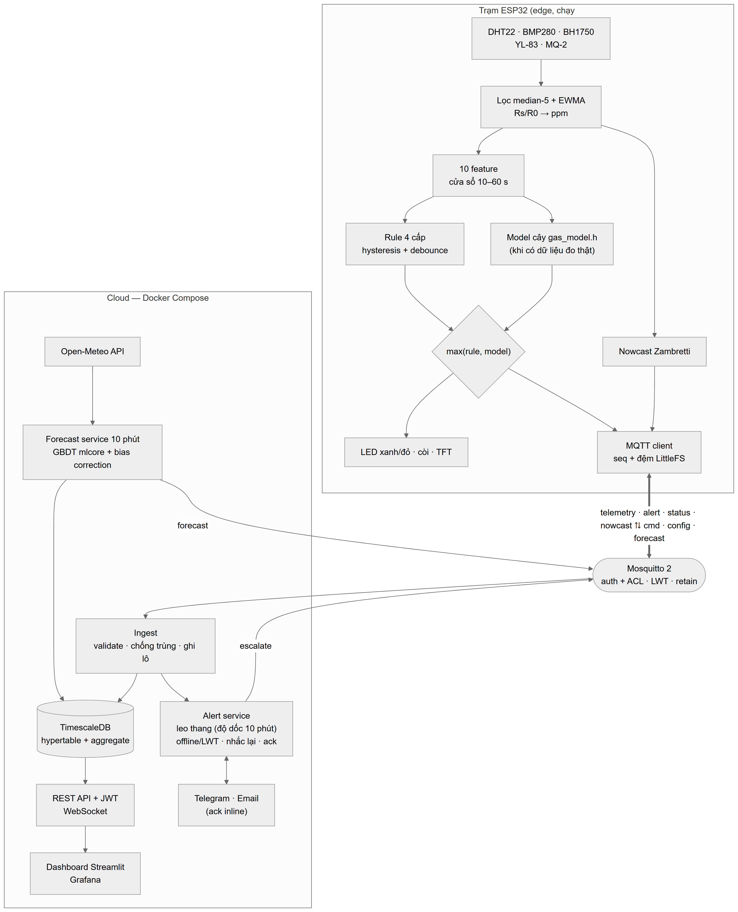

*Hình 3.1 — Kiến trúc tổng thể (nguồn: `docs/architecture/diagrams.md`; bản draw.io: `docs/architecture/system_block_diagram.drawio`).*

Phân công edge–cloud:

| Tác vụ | Nơi chạy | Lý do |
|---|---|---|
| Lọc tín hiệu, tính ppm | Edge | Cần tần số 1 Hz, dữ liệu thô không cần gửi đi |
| Cảnh báo khí 4 cấp (rule; + Random Forest khi có dữ liệu đo thật) | Edge | Độ trễ < 1 s, phải chạy khi mất mạng |
| Nowcast Zambretti | Edge | Hiển thị trên màn TFT ngay cả khi offline |
| Xác nhận/leo thang cảnh báo (độ dốc 10 phút; Isolation Forest khi đủ dữ liệu trạm) | Cloud | Cần ngữ cảnh dài, mô hình lớn hơn |
| Dự báo 1/3/6 giờ (GBDT) | Cloud | Cần ≥ 30 giờ lịch sử + Open-Meteo, 2 700+ cây |
| Thông báo Telegram/Email, lưu trữ, dashboard | Cloud | Cần Internet và lưu trữ |

### 3.2 Phần cứng và sơ đồ chân

| Linh kiện | Chân ESP32 | Ghi chú |
|---|---|---|
| BMP280, BH1750 | SDA 21, SCL 22 (I²C) | Địa chỉ 0x76, 0x23 |
| DHT22 | GPIO 4 | Điện trở kéo lên 10 kΩ |
| YL-83 | AO 34, DO 35, nguồn 18 | Chỉ cấp nguồn khi đọc |
| MQ-2 | AO 32 (qua cầu phân áp 10k/20k), DO 33 | 5 V → 3,33 V cho ADC |
| Còi active 2 chân | GPIO 25 | Nối thẳng GPIO, không cần transistor |
| LED xanh / đỏ | GPIO 26 / 14 | Không có LED vàng: cấp 1 = LED xanh nhấp nháy 1 Hz |
| Màn hình TFT 1.8" ST7735S 128×160 | CS 5, A0 16 (RX2), SDA 17 (TX2), SCK 19, RESET → EN (SPI) | Màn màu; VCC, LED nền → 3V3 |

Nhóm không dùng LED vàng, transistor S8050 và module relay/quạt; firmware chọn cấu hình bằng cờ trong `config.h`
(`HAS_LED_YELLOW 0`, `HAS_RELAY 0`). Bật quạt hút tự động là hướng
phát triển.

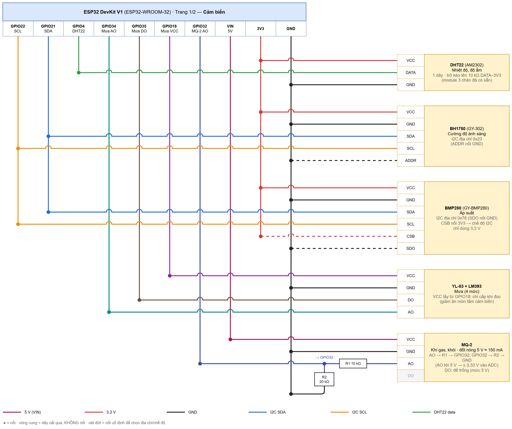

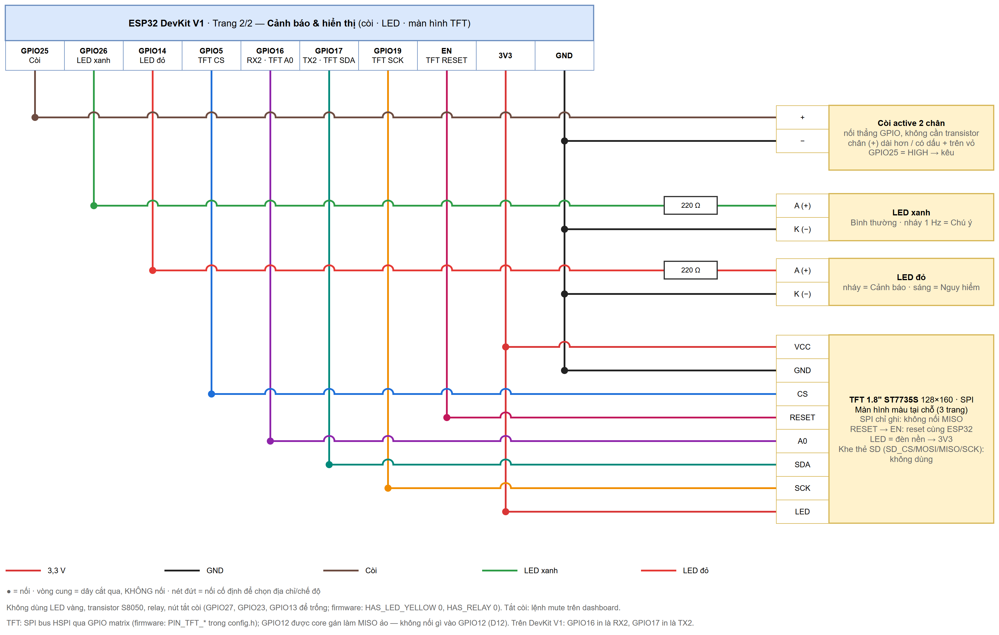

*Hình 3.2 — Sơ đồ đấu dây: (a) cảm biến, (b) cảnh báo (còi, LED) và màn hình TFT 1.8" ST7735 (SPI) (`docs/hardware/wiring.drawio`, 2 trang, mở bằng draw.io; chấm tròn = nối, vòng cung = dây cắt qua không nối; bảng chi tiết ở `docs/hardware/README.md`).*

Nguồn: `firmware/include/config.h`. ⚙ *Ảnh lắp ráp thực tế: bổ sung sau khi lắp hộp.*

### 3.3 Thiết kế MQTT

| Topic | Hướng | QoS | Retain | Nội dung |
|---|---|---|---|---|
| `vku/aiot/{id}/telemetry` | thiết bị → cloud | 0 | không | 10 s/lần (1 s khi cấp ≥ 1) |
| `vku/aiot/{id}/alert` | thiết bị → cloud | 0 | không | Khi đổi cấp: level, prev_level, cause, score |
| `vku/aiot/{id}/status` | thiết bị → cloud | 0 | có | online/offline (LWT), RSSI, heap, uptime |
| `vku/aiot/{id}/nowcast` | thiết bị → cloud | 0 | có | Zambretti 10 phút/lần |
| `vku/aiot/{id}/cmd` | cloud → thiết bị | 1 | không | mute, test_alarm, calibrate, reboot, escalate, ota |
| `vku/aiot/{id}/config` | cloud → thiết bị | 1 | có | Ngưỡng, hysteresis, debounce, chu kỳ, chế độ |
| `vku/aiot/{id}/forecast` | cloud → thiết bị | 1 | có | Tóm tắt dự báo cho màn hình TFT |
| `vku/aiot/{id}/ack` | thiết bị → cloud | 0 | không | Xác nhận lệnh/cấu hình |

### 3.4 Cơ sở dữ liệu

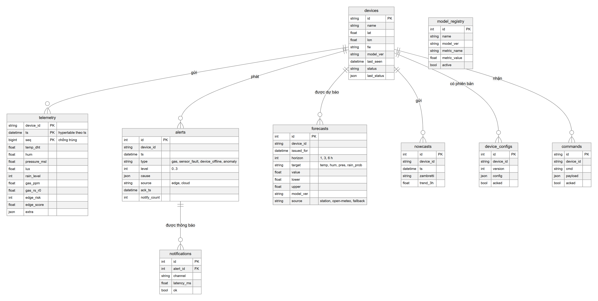

*Hình 3.3 — Lược đồ CSDL (`backend/app/db/models.py`).*

- `telemetry` là **hypertable** TimescaleDB theo `ts`, khoá chính (device_id, ts, seq) đồng thời dùng chống trùng khi
  thiết bị gửi bù.
- Ba **continuous aggregate** `telemetry_1m`, `telemetry_10m`, `telemetry_1h` tự làm mới; **retention** 90 ngày cho dữ liệu
  thô (migration `backend/app/db/migrations/versions/0001_initial.py`). Với SQLite (môi trường dev) các phần riêng của
  Timescale được bỏ qua.

### 3.5 Sơ đồ tuần tự

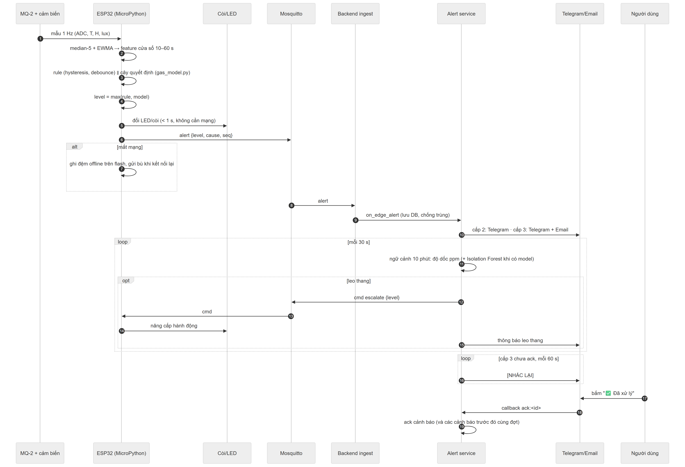

*Hình 3.4 — Luồng cảnh báo: edge quyết định, cloud xác nhận và leo thang.*

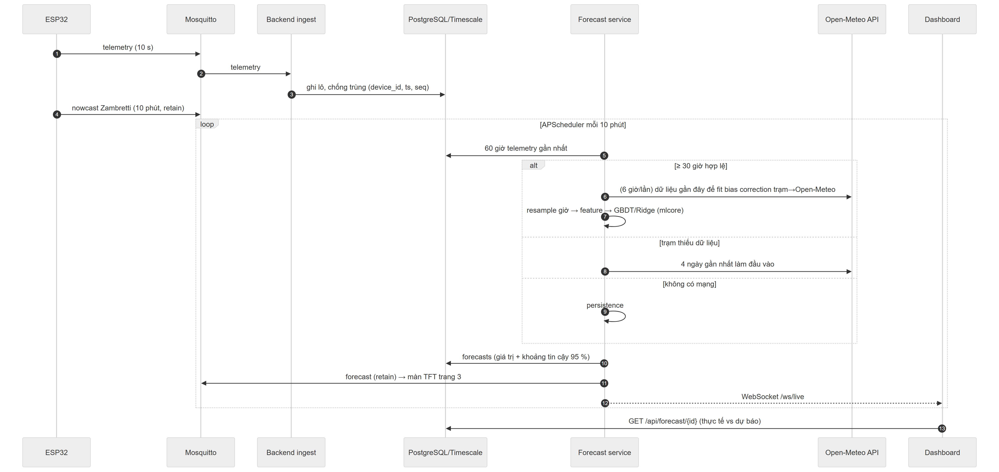

*Hình 3.5 — Luồng dự báo thời tiết.*

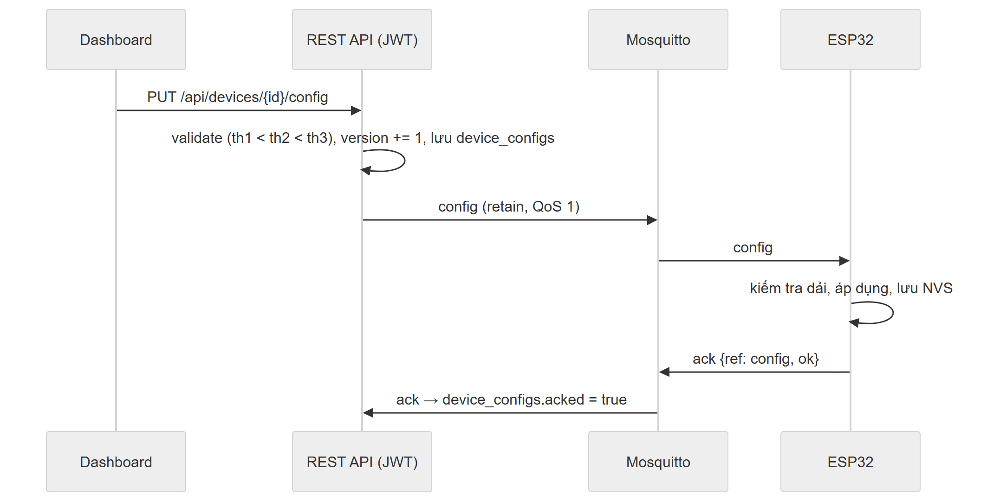

*Hình 3.6 — Luồng cấu hình thiết bị (có phiên bản và xác nhận).*

### 3.6 Thiết kế cảnh báo đa cấp

| Cấp | Tên | Điều kiện rule (mặc định) | Hành động tại edge | Thông báo cloud |
|---|---|---|---|---|
| 0 | Bình thường | ppm < 300 | LED xanh | — |
| 1 | Chú ý | ppm ≥ 300 hoặc độ dốc ≥ 15 ppm/s | LED xanh nhấp nháy | Log + dashboard |
| 2 | Cảnh báo | ppm ≥ 1000 | LED đỏ nháy, còi ngắt quãng | Telegram |
| 3 | Nguy hiểm | ppm ≥ 2000 hoặc (ppm ≥ 1000 và nhiệt tăng ≥ 1 °C/phút) | LED đỏ, còi liên tục | Telegram + Email, nhắc lại mỗi phút tới khi ack |

- **Hysteresis 15 %:** chỉ hạ cấp khi ppm < ngưỡng × 0,85, tránh dao động quanh ngưỡng.
- **Debounce:** tăng cấp khi điều kiện đúng 3 mẫu liên tiếp (cấp 3 tăng ngay), hạ cấp sau 5 mẫu.
- **Fusion:** level = max(rule, model) — mô hình chỉ có thể nâng cấp sớm hơn, không bao giờ hạ cấp mà rule đưa ra (an toàn).
- **Tắt còi:** lệnh `mute` từ dashboard tắt còi 5 phút (LED và cấp vẫn giữ; cấp tăng thêm thì còi kêu lại); thử còi bằng
  lệnh `test_alarm`. Trạm không có nút bấm vật lý.
- **Leo thang ở cloud:** ppm tăng đều trong 10 phút (độ dốc dương ở cả hai nửa cửa sổ) hoặc Isolation Forest báo bất thường
  ⇒ nâng 1 cấp, gửi `cmd escalate` xuống thiết bị.

---

## CHƯƠNG 4. HIỆN THỰC

### 4.1 Firmware ESP32 (`firmware/`)

- PlatformIO + Arduino framework; **FreeRTOS 3 task**: `TaskSensors` (1 Hz, lọc median-5 + EWMA), `TaskEdgeAI`
  (feature, rule, Random Forest, fusion, điều khiển còi/LED), `TaskNetwork` (Wi-Fi, MQTT, NTP, đệm offline, OTA).
- **Watchdog** 30 s cho mọi task; tự kết nối lại Wi-Fi/MQTT với backoff; LWT.
- **Đệm offline** LittleFS tối đa 2 000 bản ghi JSONL, gửi bù khi có mạng (backend chống trùng theo seq).
- **Cấu hình NVS**: ngưỡng, chế độ (rule/model/hybrid), R_0 sau `calibrate`; nhận qua topic `config` và gửi ack.
- **Màn hình TFT 1.8" ST7735S (160×128, màu, SPI) 3 trang**: đo hiện tại, cấp cảnh báo, dự báo từ cloud + nowcast;
  thanh tiêu đề đổi màu theo cấp (xanh/vàng/cam/đỏ), chỉ vẽ lại dòng thay đổi nên không nháy.
- **OTA** qua HTTP(S): lệnh `{"cmd":"ota","url":"…/firmware.bin"}`.
- Kích thước bản build `esp32dev`: **RAM 15,2 %, Flash 48,3 %** (bao gồm OTA).
- Kiểm thử trên PC: `pio test -e native` — 14 test (bộ lọc, rule engine, alert manager, nowcast, mô hình C khớp Python).

### 4.2 Thư viện `mlcore` (`ml/mlcore/`)

| Module | Nội dung |
|---|---|
| `preprocessing.py` | StandardScaler, MinMax, IQR/z-score, nội suy, ma trận trễ, mã hoá chu kỳ sin/cos |
| `model_selection.py` | Chia theo thời gian, TimeSeriesSplit, grid search |
| `linear.py`, `smoothing.py` | OLS/Ridge/Logistic, Holt-Winters |
| `tree.py`, `ensemble.py` | CART histogram, Random Forest, GBDT (MSE, log-loss), early stopping |
| `anomaly.py` | Isolation Forest, CUSUM, z-score theo giờ |
| `nn.py`, `optim.py` | MLP, GRU + BPTT; SGD, Momentum, Adam, gradient clipping |
| `metrics.py`, `explain.py` | Độ đo hồi quy/phân loại, ROC-AUC, split-gain/permutation importance |
| `serialize.py`, `export_c.py` | Lưu JSON/.npz có header (phiên bản, metric); xuất cây sang C header |

**Vector hoá:** histogram tính bằng `np.bincount` trên chỉ số (nút × bin); dự đoán cây duyệt song song toàn bộ mẫu theo
mảng nút; GRU tính theo lô (batch × hidden).

**Kiểm chứng tính đúng đắn — 42 test (`ml/tests/`)**: dữ liệu đồ chơi có đáp án (cây tách đúng ngưỡng, Ridge khớp nghiệm
đóng, Holt-Winters khớp chuỗi mùa), **gradient check** sai phân hữu hạn sai số tương đối < 1e-5 cho Logistic, MLP, GRU;
round-trip lưu/nạp; kiểm tra feature không rò rỉ tương lai; rule engine hysteresis/debounce; bias correction.

### 4.3 Xuất mô hình sang C

`export_c.py` sinh `firmware/include/gas_model.h` gồm các mảng `const` (feature, threshold, left, right, xác suất lá)
và hàm `gas_model_predict_proba()` duyệt cây bằng vòng lặp (không đệ quy). Tính đúng đắn của bộ xuất được kiểm chứng bằng
unit test (`ml/tests/test_export_c.py`): biên dịch header bằng g++, so dự đoán C với Python trên cùng dữ liệu kiểm thử —
**lệch lớp 0, lệch xác suất < 1e-6** cho cả cây đơn và Random Forest.

Hiện **chưa có dữ liệu khí đo thật** nên `gas_model.h` ở trạng thái `GAS_MODEL_AVAILABLE = 0`: firmware tự chuyển sang
chế độ `rule`. Khi thu được dữ liệu thí nghiệm có gán nhãn (`tools/label_logger.py`), lệnh
`python -m aiot_ml.train_gas_edge --data <csv>` huấn luyện, chọn mô hình, sinh lại `gas_model.h` và vector kiểm thử cho
Unity test `firmware/test/test_gas_model` (chạy trên PC và ESP32, đo µs/lần suy luận).

### 4.4 Backend (`backend/`)

- **FastAPI** + SQLAlchemy 2 + Alembic; PostgreSQL/TimescaleDB (sản phẩm) hoặc SQLite (phát triển).
- **Ingest MQTT** (paho-mqtt v2): validate Pydantic, loại giá trị ngoài dải vật lý (ghi vào `extra.rejected`),
  chống trùng, ghi theo lô, đẩy WebSocket `/ws/live`.
- **Alert service**: chính sách thông báo theo cấp, cooldown theo (thiết bị, cấp), nhắc lại cấp 3, leo thang
  (độ dốc 10 phút; Isolation Forest khi đã huấn luyện trên dữ liệu trạm), phát hiện offline (> 60 s hoặc LWT), ack qua API hoặc nút inline Telegram.
- **Forecast service** (APScheduler 10 phút): lấy 60 giờ telemetry → resample giờ → **bias correction trạm→Open-Meteo**
  (Ridge, có cơ chế dự phòng chỉ hiệu chỉnh độ lệch khi tương quan kém) → feature → GBDT → khoảng tin cậy 95 %
  ŷ ± 1,96·RMSE_test. Thứ tự dự phòng: dữ liệu trạm → Open-Meteo 4 ngày gần nhất → persistence. Bản tin tóm tắt 6 giờ sáng.
- **REST API** (Swagger `/docs`, JWT): thiết bị, telemetry (raw/1m/10m/1h/1d), xuất CSV, cảnh báo + ack, dự báo, nowcast,
  cấu hình (có phiên bản), lệnh, model registry.
- Kiểm thử: **20 test** (`backend/tests/`), gồm integration test với Mosquitto thật (ingest, chống trùng khi gửi bù,
  lệnh xuống thiết bị, LWT → offline).

### 4.5 Dashboard (`dashboard/app.py`)

Streamlit 6 trang, tự đăng nhập JWT, có thể mở thẳng một trang bằng `?page=` (dùng cho link trong tin nhắn Telegram):

- **Tổng quan:** cấp cảnh báo hiện tại, số đo, dự báo mới nhất, cảnh báo gần đây.
- **Biểu đồ:** cửa sổ 1 giờ / 24 giờ / 7 ngày, tải CSV.
- **Dự báo:** thực tế và dự báo kèm khoảng tin cậy 95 %, xác suất mưa.
- **Cảnh báo:** dòng thời gian, lọc theo cấp/nguồn, nút xác nhận.
- **Thiết bị:** lệnh (thử còi, tắt còi, hiệu chuẩn R0, khởi động lại) và form cấu hình ngưỡng.
- **Mô hình:** model registry đang hoạt động và các bảng kết quả.

Dashboard có 8 smoke test (`dashboard/tests/`) render cả 6 trang, kiểm tra khung tình trạng cảm biến, bấm xác nhận cảnh báo và gửi cấu hình, với API được thay bằng
phản hồi đã chụp từ backend chạy cùng trạm thật (`capture_fixture.py`). Ngoài ra có dashboard **Grafana** được provision sẵn (profile `monitoring`) đọc trực tiếp TimescaleDB:
nhiệt độ, độ ẩm, áp suất, ppm với vùng ngưỡng, cấp rủi ro edge, bảng cảnh báo.

⚙ *Ảnh chụp màn hình dashboard/Grafana: chụp khi trạm thật đã gửi dữ liệu.*

### 4.6 Triển khai Docker

`docker compose up -d --build` dựng 4 dịch vụ (Mosquitto 2.0.20, TimescaleDB 2.17/PG16, backend, dashboard) và Grafana
tuỳ chọn; mọi dịch vụ có healthcheck và thứ tự khởi động theo `depends_on: service_healthy`. Broker tự sinh file mật
khẩu từ biến môi trường mỗi lần khởi động; backend chạy `alembic upgrade head` trước khi phục vụ. Đã chạy thử thành công
trên Docker Desktop (Windows 11/WSL2): migration tạo hypertable, 3 continuous aggregate và chính sách retention; broker,
ingest và forecast service (nạp model mlcore) chạy trong container.

---

## CHƯƠNG 5. THỰC NGHIỆM VÀ ĐÁNH GIÁ

### 5.1 Dự báo thời tiết

**Dữ liệu.** Open-Meteo theo giờ tại VKU: huấn luyện 2021-01-02 → 2023-12-31, validation 2024, **kiểm tra 2025**
(chia theo thời gian, không xáo trộn). 56 feature: giá trị hiện tại, chênh lệch so với 1/2/3/6/12/24 giờ trước, trung
bình/độ lệch chuẩn trượt 3/6/24 giờ, xu hướng áp suất 3 giờ, tỉ lệ giờ mưa, số giờ từ lần mưa trước, mây, mã hoá sin/cos
giờ trong ngày và ngày trong năm, cos góc thiên đỉnh mặt trời. Mục tiêu hồi quy là **độ thay đổi** y = x(t+h) − x(t).

**Kết quả hồi quy — MAE (RMSE) trên tập test 2025** (`docs/report/results_forecast.md`):

| Mô hình | Nhiệt 1h | Nhiệt 3h | Nhiệt 6h | Ẩm 1h | Ẩm 3h | Ẩm 6h | Áp 1h | Áp 3h | Áp 6h |
|---|---|---|---|---|---|---|---|---|---|
| Persistence | 0,593 | 1,559 | 2,759 | 2,968 | 7,541 | 13,210 | 0,520 | 1,374 | 1,968 |
| Seasonal naive | 0,994 | 0,993 | 0,992 | 4,919 | 4,923 | 4,930 | 1,434 | 1,434 | 1,433 |
| Holt-Winters | 0,422 | 0,821 | 0,925 | 2,384 | 4,299 | 4,766 | 0,239 | 0,447 | 0,654 |
| Ridge | 0,348 | 0,690 | 0,837 | 2,045 | 3,822 | 4,515 | 0,234 | 0,460 | 0,627 |
| **GBDT** | **0,299** | **0,543** | **0,688** | **1,856** | **3,244** | **3,980** | **0,211** | **0,388** | **0,563** |
| GRU (NumPy) | 0,310 | 0,556 | 0,714 | 1,932 | 3,295 | 4,052 | 0,216 | 0,405 | 0,594 |

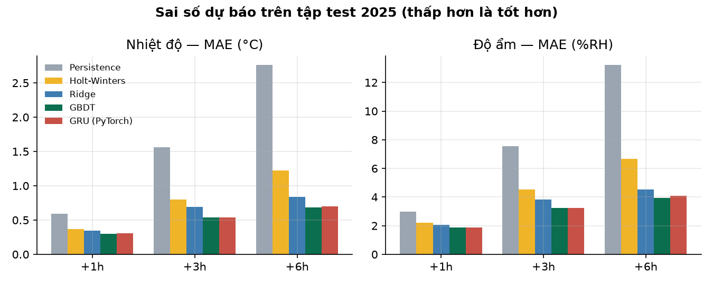

*Hình 5.1 — MAE theo mô hình và tầm dự báo.*

**Dự báo mưa — F1 / ROC-AUC / Brier** (ngưỡng chọn trên validation):

| Mô hình | Mưa 1h | Mưa 3h | Mưa 6h |
|---|---|---|---|
| Persistence | 0,826 / 0,865 / 0,124 | 0,783 / 0,813 / 0,178 | 0,723 / 0,766 / 0,254 |
| Logistic | 0,826 / 0,931 / 0,096 | 0,826 / 0,915 / 0,116 | 0,836 / 0,900 / 0,127 |
| **GBDT** | **0,833 / 0,939 / 0,091** | **0,839 / 0,926 / 0,107** | **0,854 / 0,912 / 0,119** |

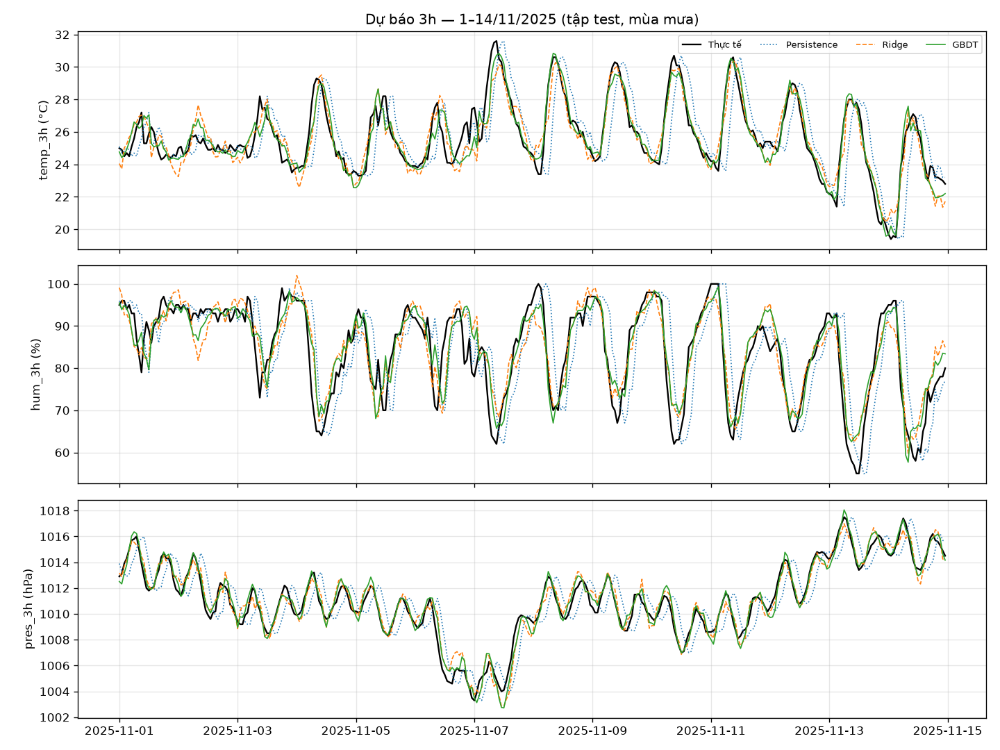

*Hình 5.2 — Dự báo 3 giờ trong 14 ngày đầu tháng 11/2025 (mùa mưa, tập test).*

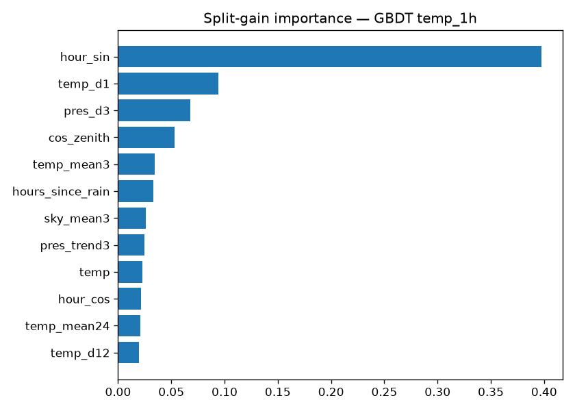

*Hình 5.3 — Split-gain importance của GBDT nhiệt độ 1 giờ.*

**Thảo luận.**
- GBDT tốt nhất ở **mọi** cặp biến × tầm; so với persistence, MAE nhiệt độ 6 giờ giảm 75 % (2,76 → 0,69 °C), độ ẩm 6 giờ
  giảm 70 % (13,2 → 3,98 %RH).
- Persistence kém ở tầm 3–6 giờ vì chu kỳ ngày mạnh; seasonal naive (giá trị cùng giờ hôm trước) ổn định theo tầm nhưng
  không theo kịp thay đổi thời tiết.
- GRU tự viết đạt gần GBDT (kém 2–5 %) nhưng huấn luyện chậm hơn nhiều; GBDT được chọn làm mô hình triển khai.
- Feature quan trọng nhất là `hour_sin` (chu kỳ ngày), `temp_d1` (quán tính), xu hướng áp suất 3 giờ và góc thiên đỉnh
  — phù hợp hiểu biết vật lý. Permutation importance cho thứ hạng tương tự.
- Chi phí: huấn luyện 8–17 s/mô hình (123–313 cây), suy luận 18–46 µs/mẫu trên PC.
- **Bias correction trạm→Open-Meteo:** model học trên dữ liệu tái phân tích; đầu vào trạm được ánh xạ tuyến tính về thang
  Open-Meteo trước khi dự báo và đổi ngược sau đó. ⚙ *Cần ≥ 2 tuần dữ liệu trạm thật để đánh giá độ lệch cảm biến
  (so sánh trạm với Open-Meteo, task.md §12.2).*

### 5.2 Cảnh báo khí/khói tại edge

**Trạng thái.** Chưa có dữ liệu MQ-2 đo thật ⇒ chưa huấn luyện mô hình; trạm chạy **chế độ rule**: ngưỡng 300 / 1 000 /
2 000 ppm (2 000 ppm ≈ 10 % LEL của LPG), tăng cấp khi ppm tăng nhanh (≥ 15 ppm/s) hoặc nhiệt độ tăng ≥ 1 °C/phút,
hysteresis 15 %, debounce 3 mẫu khi tăng (cấp 3 tăng ngay) và 5 mẫu khi giảm. Logic này được kiểm thử bằng unit test
native (`firmware/test/test_rules`) và bản Python tương ứng (`ml/tests/test_pipeline.py`).

**Kế hoạch thu dữ liệu và đánh giá** (⚙ chờ thực hiện):
1. Thu dữ liệu 1 Hz bằng `tools/label_logger.py`: không khí sạch ở nhiều mức nhiệt/ẩm (nhãn 0); bật lửa gas xả, không
   đốt, ở 50 / 20 / 5 cm (nhãn 1/2/3); khói nhang/giấy trong hộp kín (nhãn 2); các nguồn nhiễu hơi nước, cồn, nước hoa
   (nhãn 0, dùng để đo báo động giả). Mỗi kịch bản lặp 10–20 lần qua nhiều buổi.
2. `python -m aiot_ml.train_gas_edge --data <csv>`: chia train/val/test **theo buổi thí nghiệm**, chọn giữa Decision Tree
   và Random Forest nhỏ với trọng số lớp ưu tiên Recall cấp ≥ 2.
3. So sánh Rule / Model / Hybrid trên tập test: Macro-F1, Recall/Precision cấp ≥ 2 (theo mẫu và theo sự kiện), tỉ lệ báo
   động giả trên sự kiện nhiễu, độ trễ phát hiện trung vị/P95. Kết quả ghi tự động vào `docs/report/results_gas_edge.md`.

### 5.3 Phát hiện bất thường ở cloud

**Trạng thái.** Isolation Forest (cửa sổ 10 phút: trung bình/độ lệch/độ dốc ppm, nhiệt, ẩm, giờ trong ngày), z-score theo
giờ và CUSUM trên R_0 hằng ngày đã được cài đặt trong `mlcore` và có pipeline `train_anomaly.py`, nhưng **cần vài tuần
telemetry thật của trạm** để học trạng thái bình thường. Khi chưa có mô hình, backend bỏ qua bước này và leo thang cảnh
báo dựa trên độ dốc ppm 10 phút. ⚙ Sau khi trạm chạy ≥ 3 tuần: xuất telemetry, chạy
`python -m aiot_ml.train_anomaly --data <csv>`, đánh giá trên các sự cố được ghi nhận.

### 5.4 Hiệu năng hệ thống

**Kiểm thử tải** (`tools/load_test.py`, mỗi thiết bị ảo gửi 1 bản tin/giây, QoS 1, 30 s; nội dung bản tin chỉ dùng để
tạo tải — số liệu đo ở đây là độ trễ và tài nguyên thật của hệ thống):

| Kịch bản | Gửi / nhận | Mất gói | P50 / P95 / P99 broker | Vào CSDL | CPU backend TB |
|---|---|---|---|---|---|
| 20 thiết bị, SQLite | 560 / 560 | 0 % | 0,6 / 2,0 / 3,1 ms | 100 % | 54,5 % |
| 50 thiết bị, SQLite | 1 400 / 1 400 | 0 % | 0,6 / 2,2 / 4,1 ms | 100 % | 61,4 % |
| 50 thiết bị, Docker + TimescaleDB | 1 505 / 1 505 | 0 % | 1,7 / 3,4 / 4,4 ms | 100 % | 9,8 % |

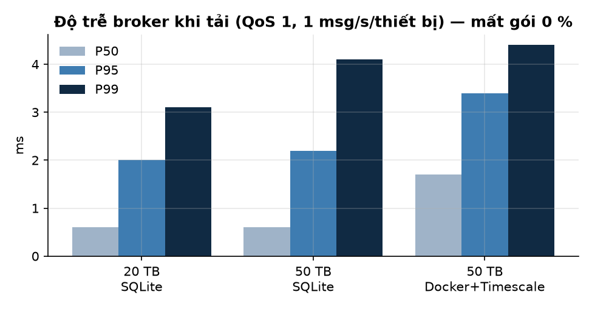

*Hình 5.4 — Độ trễ broker khi tải.*

Một trạm thật gửi 0,1 bản tin/giây, nên 50 bản tin/giây tương đương ~500 trạm. Với TimescaleDB, CPU backend trung bình chỉ
≈ 10 % một lõi, RAM các container: backend 133 MB, DB 97 MB, Mosquitto 18 MB.

**Độ trễ** — bảng cần hoàn thiện khi có phần cứng:

| Đoạn | Phương pháp | Kết quả |
|---|---|---|
| Thiết bị phát alert → backend gửi thông báo | ⚙ trạm thật + Mosquitto | *chờ đo* |
| Xả gas → còi kêu (edge) | ⚙ đo bằng video/đồng hồ, ≥ 10 lần | *chờ đo* |
| Xả gas → tin Telegram (end-to-end) P50/P95 | ⚙ bảng `notifications.latency_ms` | *chờ đo* |

### 5.5 Tài nguyên edge

| Hạng mục | Giá trị |
|---|---|
| Flash firmware | 48,0 % (943 kB / 1,9 MB phân vùng app, bản chỉ có rule) |
| RAM tĩnh | 14,9 % (của 320 kB) |
| Mô hình khí | Chưa có (chờ dữ liệu đo thật); ⚙ đo kích thước và µs/lần suy luận sau khi huấn luyện: `pio test -e esp32dev -f test_gas_model` |
| Công suất tiêu thụ | ⚙ đo dòng bằng USB meter (MQ-2 đốt nóng ≈ 150 mA) |

### 5.6 Độ bền và tình huống lỗi

| Kiểm thử | Trạng thái |
|---|---|
| Chống trùng khi gửi bù (cùng seq) | ✔ integration test |
| LWT khi mất kết nối đột ngột → offline + cảnh báo `device_offline` | ✔ integration test + Docker |
| Cảnh báo edge khi mất Wi-Fi, đệm offline, gửi bù | ✔ logic trong firmware + test native; ⚙ kiểm tra trên thiết bị |
| Chạy liên tục ≥ 72 giờ (heap, số lần reconnect, WDT reset) | ⚙ chờ đo (topic `status` có `free_heap`, `uptime_s`) |
| Báo động giả: hơi nước, cồn, nước hoa | ⚙ chờ đo (theo datasheet MQ-2 nhạy chéo với cồn) |

---

## CHƯƠNG 6. KẾT LUẬN VÀ HƯỚNG PHÁT TRIỂN

### 6.1 Kết quả đạt được

| Mục tiêu / KPI | Kết quả | Đánh giá |
|---|---|---|
| Dự báo 1/3/6 giờ vượt persistence | GBDT tốt hơn ở 9/9 cặp hồi quy và 3/3 tầm mưa | ✔ Đạt |
| MAE nhiệt độ 1 giờ, độ ẩm 1 giờ, F1 mưa 3 giờ | 0,30 °C; 1,86 %RH; 0,839 | ✔ Đạt |
| Cảnh báo 4 cấp tại edge, hysteresis/debounce, chạy offline | Có (rule), kiểm thử native | ✔ Đạt (⚙ xác nhận trên phần cứng) |
| Bộ xuất mô hình sang C khớp Python | Lệch 0 (unit test) | ✔ Đạt |
| Mô hình ML cảnh báo khí, Recall cấp ≥ 2 | Chưa có dữ liệu khí đo thật | ⚙ Chờ dữ liệu thật |
| Cloud xác nhận/leo thang, Telegram/Email, ack | Có | ✔ Đạt |
| Chịu tải ≥ 50 thiết bị, mất gói ≈ 0 | 0 % ở 50 thiết bị | ✔ Đạt |
| Toàn bộ ML tự viết, không thư viện ML | `mlcore` + 42 test | ✔ Đạt |
| `docker compose up` dựng lại backend, README | Đã chạy thử | ✔ Đạt |
| Gửi MQTT ổn định ≥ 72 giờ, độ trễ end-to-end thật | — | ⚙ Chờ phần cứng |

### 6.2 Hạn chế

- Chưa có dữ liệu khí MQ-2 đo thật: edge mới chạy luật ngưỡng; Random Forest (edge) và Isolation Forest (cloud) đã cài
  đặt, có pipeline huấn luyện nhưng chưa huấn luyện.
- MQ-2 nhạy chéo (cồn, H₂) và trôi theo thời gian; ppm chỉ mang tính tương đối.
- Dự báo dựa trên một điểm đo, không có thông tin quy mô lớn (ảnh vệ tinh, mô hình số trị) nên giới hạn ở vài giờ.
- PubSubClient chỉ hỗ trợ QoS 0 khi publish; TLS (cổng 8883) đã chuẩn bị nhưng chưa thử trên thiết bị.

### 6.3 Hướng phát triển

- Thu dữ liệu khí thật, huấn luyện lại và cập nhật mô hình xuống thiết bị qua OTA.
- Thêm MQ-135/MQ-5 để giảm nhạy chéo; cảm biến bụi PM2.5; relay + quạt hút bật tự động ở cấp ≥ 2.
- Truyền thông LoRa/NB-IoT, nguồn pin + năng lượng mặt trời, nhiều trạm (mesh) để dự báo theo không gian.
- Federated learning giữa các trạm; lượng tử hoá mô hình (int8) để chạy mô hình lớn hơn trên edge.
- Gửi mô hình qua MQTT (OTA model) thay vì cập nhật toàn bộ firmware.

---

## TÀI LIỆU THAM KHẢO

1. Hanwei Electronics. *MQ-2 Semiconductor Sensor for Combustible Gas — Technical Data*.
2. Bosch Sensortec. *BMP280 Digital Pressure Sensor — Datasheet*, BST-BMP280-DS001.
3. Aosong Electronics. *AM2302/DHT22 Digital Temperature and Humidity Sensor*.
4. ROHM. *BH1750FVI Ambient Light Sensor IC — Datasheet*.
5. OASIS. *MQTT Version 3.1.1*, 2014.
6. L. Breiman. "Random Forests", *Machine Learning* 45(1), 2001.
7. J. H. Friedman. "Greedy Function Approximation: A Gradient Boosting Machine", *Annals of Statistics* 29(5), 2001.
8. T. Chen, C. Guestrin. "XGBoost: A Scalable Tree Boosting System", *KDD*, 2016.
9. F. T. Liu, K. M. Ting, Z.-H. Zhou. "Isolation Forest", *ICDM*, 2008.
10. E. S. Page. "Continuous Inspection Schemes", *Biometrika* 41, 1954.
11. K. Cho et al. "Learning Phrase Representations using RNN Encoder–Decoder for Statistical Machine Translation", *EMNLP*, 2014.
12. C. C. Holt (1957); P. R. Winters. "Forecasting Sales by Exponentially Weighted Moving Averages", *Management Science* 6, 1960.
13. D. P. Kingma, J. Ba. "Adam: A Method for Stochastic Optimization", *ICLR*, 2015.
14. Open-Meteo. *Historical Weather API* (ERA5 / ERA5-Land), https://open-meteo.com.
15. NIOSH Pocket Guide to Chemical Hazards — LPG (LEL 2,0 %); OSHA.
16. Negretti & Zambra. *Zambretti Forecaster*, 1915.

---

## PHỤ LỤC A. Hướng dẫn chạy lại kết quả

```bash
# môi trường
python -m venv .venv && .venv/Scripts/python -m pip install -r backend/requirements.txt -r ml/requirements.txt streamlit
.venv/Scripts/python -m pip install -e ml
# kiểm thử
cd ml && ../.venv/Scripts/python -m pytest -q            # 42 test
cd backend && ../.venv/Scripts/python -m pytest -q tests # 20 test
cd firmware && pio test -e native                        # 14 test
pytest -q dashboard/tests                                # 7 test
# huấn luyện lại
cd ml && python -m aiot_ml.train_forecast
python -m aiot_ml.train_gas_edge --data data/raw/gas_labeled.csv   # khi có dữ liệu khí đo thật (label_logger.py)
python -m aiot_ml.train_anomaly --data <telemetry.csv>             # khi trạm đã chạy vài tuần
# toàn hệ thống (dữ liệu từ trạm ESP32 thật)
docker compose up -d --build
# hình cho báo cáo
python tools/make_report_figures.py --api http://localhost:8000
```

## PHỤ LỤC B. Kịch bản demo

Xem `docs/report/kich_ban_demo.md`.
